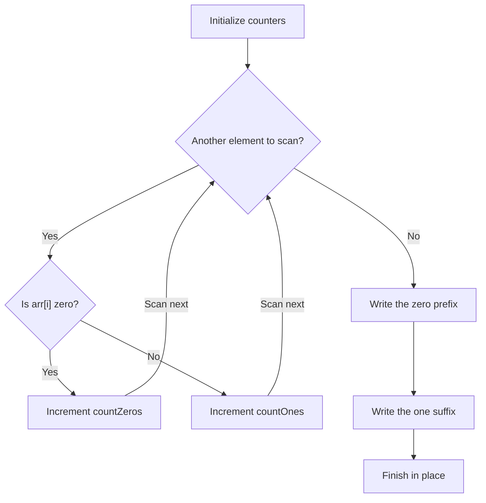

# Rearrange 0 and 1

<!-- patternbook-study-guide:v2 -->

[Practice problem](https://www.geeksforgeeks.org/problems/segregate-0s-and-1s5106/1)

## Complexity comparison

Let n be the number of elements. All three methods write into the original vector.

The input contains only zeros and ones. The submitted else branch counts every nonzero value as a one.

| Approach | Time | Auxiliary space | Trade-off |
|---|---|---|---|
| Your submission — Count and rewrite | O(n) | O(1) | The rewrite performs exactly n array assignments, even for already partitioned input. |
| Recommended — Two-end partition | O(n) | O(1) | Same asymptotic bounds. Already partitioned inputs need no swaps. |
| Common approach — Count zeros and fill | O(n) | O(1) | Two passes with predictable sequential writes. |

## Your submission — Count and rewrite

Count both values, then use countZeros as the boundary between the zero prefix and one suffix. countOnes is incremented but never read.

```cpp
class Solution {
  public:
    void segregate0and1(vector<int> &arr) {
        // code here
        int n = arr.size();
        
        int countZeros = 0;
        int countOnes = 0;
        
        for(int i = 0 ; i< n; i++) {
            if(arr[i]==0) {
                countZeros++;
            }
            
            else{
                countOnes++;
            }
        }
        
        for(int i = 0 ; i<countZeros; i++) {
            arr[i] = 0;
        }
        
        for(int i = countZeros; i<n; i++) {
            arr[i] = 1;
        }
    }
};
```

### How your code runs



[Open interactive flowchart](https://amit-dsa-practice-log.russetfruit64.chatgpt.site/flow.html#WyJSZWFycmFuZ2UgMCBhbmQgMSIsW1siSW5pdGlhbGl6ZSBjb3VudGVycyIsIlNldCBjb3VudFplcm9zIGFuZCBjb3VudE9uZXMgdG8gemVyby4gU3RhcnQgc2Nhbm5pbmcgYXQgaW5kZXggemVyby4iXSxbIkFub3RoZXIgZWxlbWVudCB0byBzY2FuPyIsIlRoZSBmaXJzdCBsb29wIHJlYWRzIGFycltpXSBvbmx5IHdoaWxlIGkgPCBuLiJdLFsiSXMgYXJyW2ldIHplcm8/IiwiRXhhY3RseSBvbmUgY291bnRlciBpcyBpbmNyZW1lbnRlZCBmb3IgdGhpcyBlbGVtZW50LiJdLFsiSW5jcmVtZW50IGNvdW50WmVyb3MiLCJUaGUgemVybyBwcmVmaXggd2lsbCBuZWVkIG9uZSBhZGRpdGlvbmFsIHNsb3QuIFRoZSBmb3ItbG9vcCBpbmNyZW1lbnQgYWR2YW5jZXMgaS4iXSxbIkluY3JlbWVudCBjb3VudE9uZXMiLCJUaGlzIHJlY29yZHMgYSBvbmUuIFRoZSBmb3ItbG9vcCBpbmNyZW1lbnQgYWR2YW5jZXMgaS4iXSxbIldyaXRlIHRoZSB6ZXJvIHByZWZpeCIsIlRoZSBzZWNvbmQgbG9vcCB3cml0ZXMgMCBhdCBpbmRpY2VzIDAgdGhyb3VnaCBjb3VudFplcm9zIOKIkiAxLiJdLFsiV3JpdGUgdGhlIG9uZSBzdWZmaXgiLCJUaGUgdGhpcmQgbG9vcCBzdGFydHMgYXQgY291bnRaZXJvcyBhbmQgd3JpdGVzIDEgdGhyb3VnaCBpbmRleCBuIOKIkiAxLiJdLFsiRmluaXNoIGluIHBsYWNlIiwiVGhlIHByZWZpeCBjb250YWlucyBldmVyeSB6ZXJvIGFuZCB0aGUgc3VmZml4IGNvbnRhaW5zIGV2ZXJ5IG9uZS4gVGhlIGZ1bmN0aW9uIHJldHVybnMgdm9pZC4iXV0sW1swLDEsIiJdLFsxLDIsIlllcyJdLFsxLDUsIk5vIl0sWzIsMywiWWVzIl0sWzIsNCwiTm8iXSxbMywxLCJTY2FuIG5leHQiXSxbNCwxLCJTY2FuIG5leHQiXSxbNSw2LCIiXSxbNiw3LCIiXV1d) · [Start the clickable walkthrough](#flow-step-1)

| Select a step | Follow a path |
|---|---|
| [1. Initialize counters](#flow-step-1) | Continue → [Step 2](#flow-step-2) |
| [2. Another element to scan?](#flow-step-2) | Yes → [Step 3](#flow-step-3) · No → [Step 6](#flow-step-6) |
| [3. Is arr i zero?](#flow-step-3) | Yes → [Step 4](#flow-step-4) · No → [Step 5](#flow-step-5) |
| [4. Increment countZeros](#flow-step-4) | Scan next → [Step 2](#flow-step-2) |
| [5. Increment countOnes](#flow-step-5) | Scan next → [Step 2](#flow-step-2) |
| [6. Write the zero prefix](#flow-step-6) | Continue → [Step 7](#flow-step-7) |
| [7. Write the one suffix](#flow-step-7) | Continue → [Step 8](#flow-step-8) |
| [8. Finish in place](#flow-step-8) | Finish |

#### Flow step 1

**Initialize counters** — Set countZeros and countOnes to zero. Start scanning at index zero.

**Continue** → [Step 2](#flow-step-2) · Another element to scan?

#### Flow step 2

**Another element to scan?** — The first loop reads arr[i] only while i < n.

**Yes** → [Step 3](#flow-step-3) · Is arr i zero?  
**No** → [Step 6](#flow-step-6) · Write the zero prefix

#### Flow step 3

**Is arr i zero?** — Exactly one counter is incremented for this element.

**Yes** → [Step 4](#flow-step-4) · Increment countZeros  
**No** → [Step 5](#flow-step-5) · Increment countOnes

#### Flow step 4

**Increment countZeros** — The zero prefix will need one additional slot. The for-loop increment advances i.

**Scan next** → [Step 2](#flow-step-2) · Another element to scan?

#### Flow step 5

**Increment countOnes** — This records a one. The for-loop increment advances i.

**Scan next** → [Step 2](#flow-step-2) · Another element to scan?

#### Flow step 6

**Write the zero prefix** — The second loop writes 0 at indices 0 through countZeros − 1.

**Continue** → [Step 7](#flow-step-7) · Write the one suffix

#### Flow step 7

**Write the one suffix** — The third loop starts at countZeros and writes 1 through index n − 1.

**Continue** → [Step 8](#flow-step-8) · Finish in place

#### Flow step 8

**Finish in place** — The prefix contains every zero and the suffix contains every one. The function returns void.

Finished. [Restart at step 1](#flow-step-1)

### Worked example

For `[0,1,0,1,0]`, the `(zeros, ones)` counts progress through `(1,0)`, `(1,1)`, `(2,1)`, `(2,2)`, `(3,2)`. The zero-prefix loop produces `[0,0,0,1,0]`. The suffix loop sets indices 3 and 4 to one, leaving `[0,0,0,1,1]`.

## Recommended — Two-end partition

Skip correct values at both ends. Swap only when a one on the left and a zero on the right are both misplaced.

```cpp
void segregate0and1(vector<int>& arr) {
    int l = 0, r = static_cast<int>(arr.size()) - 1;
    while (l < r) {
        while (l < r && arr[l] == 0) ++l;
        while (l < r && arr[r] == 1) --r;
        if (l < r) { swap(arr[l], arr[r]); ++l; --r; }
    }
}
```

## Common approach — Count zeros and fill

A compact counting baseline uses the same boundary as your solution. Only the zero count is needed.

```cpp
void segregate0and1(vector<int>& arr) {
    auto zeros = count(arr.begin(), arr.end(), 0);
    fill(arr.begin(), arr.begin() + zeros, 0);
    fill(arr.begin() + zeros, arr.end(), 1);
}
```

The common approach is a representative technique. Submission-frequency data is unavailable.

## Interview takeaway

Count and rewrite is already time- and space-optimal for binary input. Choose the two-end method when avoiding unnecessary writes matters.
