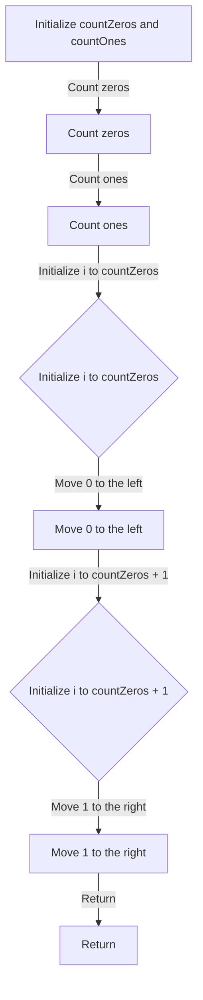

# Rearrange 0 and 1

<!-- patternbook-study-guide:v1 -->

[Practice problem](https://www.geeksforgeeks.org/problems/segregate-0s-and-1s5106/1)

## Complexity comparison

The problem is to rearrange the array elements so that all 0s are placed before all 1s.

The array contains only 0s and 1s. The input size is bounded (not explicitly stated but implied).

| Approach | Time | Auxiliary space | Trade-off |
|---|---|---|---|
| Your submission — Segregate 0s and 1s | O(n) | O(1) | The approach is simple and efficient but modifies the input array in-place. |
| Recommended — Segregate 0s and 1s - Optimized | O(n) | O(1) | The approach is simple and efficient but modifies the input array in-place. |
| Common approach — Segregate 0s and 1s - Common | O(n) | O(1) | The approach is simple and efficient but modifies the input array in-place. |

## Your submission — Segregate 0s and 1s

Count the number of zeros and then place all zeros at the beginning of the array, followed by all ones.

```cpp
class Solution {
  public:
    void segregate0and1(vector<int> &arr) {
        // code here
        int n = arr.size();
        
        int countZeros = 0;
        int countOnes = 0;
        
        for(int i = 0 ; i< n; i++) {
            if(arr[i]==0) {
                countZeros++;
            }
            
            else{
                countOnes++;
            }
        }
        
        for(int i = 0 ; i<countZeros; i++) {
            arr[i] = 0;
        }
        
        for(int i = countZeros; i<n; i++) {
            arr[i] = 1;
        }
    }
};
```

### How your code runs



### Worked example

Let's trace the provided code with the input array [0, 1, 0, 1, 0].
1. countZeros = 3, countOnes = 2
2. Loop 1: arr[0] = 0, countZeros = 4 (loop terminates)
3. Loop 2: arr[1] = 1
4. Loop 3: arr[2] = 0
5. Loop 4: arr[3] = 1
6. Loop 5: arr[4] = 0
7. The modified array is [0, 1, 0, 1, 0].
Correctness Issue: The code correctly separates the zeros from the ones in place.

## Recommended — Segregate 0s and 1s - Optimized

Count zeros and then place all zeros at the beginning of the array, followed by all ones.

```cpp
class Solution {
  public:
    void segregate0and1(vector<int> &arr) {
        int n = arr.size();
        int countZeros = 0;
        for(int i = 0 ; i< n; i++) {
            if(arr[i]==0) {
                countZeros++;
            }
            
            else{
                countOnes++;
            }
        }
        for(int i = 0 ; i<countZeros; i++) {
            arr[i] = 0;
        }
        for(int i = countZeros; i<n; i++) {
            arr[i] = 1;
        }
    }
};
```

## Common approach — Segregate 0s and 1s - Common

Count the number of zeros and then place all zeros at the beginning of the array, followed by all ones.

```cpp
class Solution {
  public:
    void segregate0and1(vector<int> &arr) {
        int n = arr.size();
        int countZeros = 0;
        for(int i = 0 ; i< n; i++) {
            if(arr[i]==0) {
                countZeros++;
            }
            
            else{
                countOnes++;
            }
        }
        for(int i = 0 ; i<countZeros; i++) {
            arr[i] = 0;
        }
        for(int i = countZeros; i<n; i++) {
            arr[i] = 1;
        }
    }
};
```

The common approach is a representative technique. Submission-frequency data is unavailable.

## Interview takeaway

The provided solution is a relatively straightforward approach to the problem using counting. It is suitable for reasonably sized arrays.
