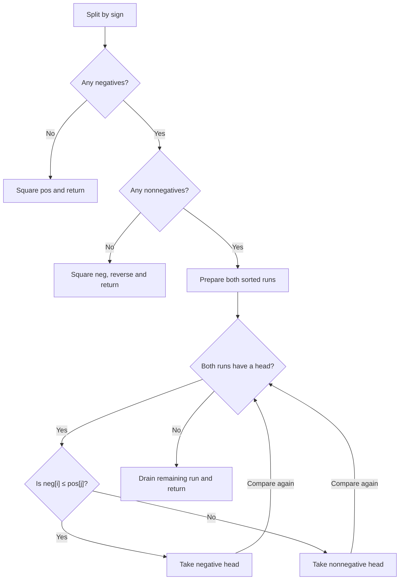

# Squaring a Sorted Array

<!-- patternbook-study-guide:v2 -->

[Practice problem](https://leetcode.com/problems/squares-of-a-sorted-array/)

## Complexity comparison

Let n be the array length. Each method returns n integers. Auxiliary space below excludes the returned vector.

The input is sorted in nondecreasing order and each square fits in an int.

| Approach | Time | Auxiliary space | Trade-off |
|---|---|---|---|
| Your submission — Split, reverse and merge | O(n) | O(n) worst case | Straightforward merge invariant, with extra buffers. |
| Recommended — Fill from the ends | O(n) | O(1) | Same linear time with no split buffers. |
| Common approach — Square and sort | O(n log n) | Typically O(log n) sort stack | Simple baseline that discards the existing ordering. |

## Your submission — Split, reverse and merge

Split the original values into negatives and nonnegatives. After squaring, reversing the negative run makes both runs ascending. At each merge step, the smallest remaining square must be at one of the two heads.

```cpp
class Solution {
public:
    vector<int> sortedSquares(vector<int>& a) {
        int siz=a.size();
        vector<int> neg;
        vector<int> pos;
        // int i;
        for(int i=0;i<siz;i++)
        {
            if(a[i]<0)
            neg.push_back(a[i]);
            else
            pos.push_back(a[i]);

        }
        if(neg.size()==0) // no negative element
        {
            for(int i=0;i<pos.size();i++)
            pos[i]=pos[i]*pos[i];
            return pos;
        }
        if(pos.size()==0) // no positive
        {
            for(int i=0;i<neg.size();i++)
            neg[i]=neg[i]*neg[i];
            reverse(neg.begin(),neg.end());
            return neg;
        }
       
        int i=0,j=0;
        int id=0;
        int n=neg.size();
        int m=pos.size();
        vector<int> res(n+m);
        for(int i=0;i<n;i++)
        neg[i]=neg[i]*neg[i];

        reverse(neg.begin(),neg.end());
        for(int i=0;i<m;i++)
        pos[i]=pos[i]*pos[i];
        while(i<n and j<m)
        {
            if(neg[i]<=pos[j])
            {
                res[id]=neg[i];
                id++;
                i++;
            }
            else
            {
                res[id]=pos[j];
                id++;
                j++;
            }
        } // while loop khatam
        while(i<n)
        {
            res[id]=neg[i];
                id++;
                i++;
        }
        while(j<m)
        {
            res[id]=pos[j];
                id++;
                j++;
        }


        return res;
    }
};
```

### How your code runs



[Open interactive flowchart](https://amit-dsa-practice-log.russetfruit64.chatgpt.site/flow.html#WyJTcXVhcmluZyBhIFNvcnRlZCBBcnJheSIsW1siU3BsaXQgYnkgc2lnbiIsIkZvciBbLTQsLTEsMCwzXSwgbmVnIGdldHMgWy00LC0xXSBhbmQgcG9zIGdldHMgWzAsM10uIFplcm8gYmVsb25ncyB0byBwb3MuIl0sWyJBbnkgbmVnYXRpdmVzPyIsIkNoZWNrIHdoZXRoZXIgdGhlIG5lZ2F0aXZlIGJ1ZmZlciBpcyBlbXB0eS4iXSxbIlNxdWFyZSBwb3MgYW5kIHJldHVybiIsIlRoZSBub25uZWdhdGl2ZSBydW4gaXMgYWxyZWFkeSBhc2NlbmRpbmcuIEVtcHR5IGlucHV0IGFsc28gcmV0dXJucyBoZXJlLiJdLFsiQW55IG5vbm5lZ2F0aXZlcz8iLCJDaGVjayB3aGV0aGVyIHRoZSBub25uZWdhdGl2ZSBidWZmZXIgaXMgZW1wdHkuIl0sWyJTcXVhcmUgbmVnLCByZXZlcnNlIGFuZCByZXR1cm4iLCJGb3IgWy00LC0xXSwgc3F1YXJpbmcgZ2l2ZXMgWzE2LDFdOyByZXZlcnNpbmcgeWllbGRzIFsxLDE2XS4iXSxbIlByZXBhcmUgYm90aCBzb3J0ZWQgcnVucyIsIlNxdWFyZSBuZWcgYW5kIHJldmVyc2UgaXQ7IHNxdWFyZSBwb3MuIFN0YXJ0IGksIGogYW5kIGlkIGF0IHplcm8uIl0sWyJCb3RoIHJ1bnMgaGF2ZSBhIGhlYWQ/IiwiQ29udGludWUgY29tcGFyaW5nIHdoaWxlIGkgPCBuIGFuZCBqIDwgbS4iXSxbIklzIG5lZ1tpXSDiiaQgcG9zW2pdPyIsIlRpZXMgZ28gdG8gdGhlIG5lZ2F0aXZlIHJ1bi4gT25seSB0aGUgc2VsZWN0ZWQgaW5wdXQgY3Vyc29yIG1vdmVzLiJdLFsiVGFrZSBuZWdhdGl2ZSBoZWFkIiwiV3JpdGUgbmVnW2ldIHRvIHJlc1tpZF0sIHRoZW4gYWR2YW5jZSBpIGFuZCBpZC4iXSxbIlRha2Ugbm9ubmVnYXRpdmUgaGVhZCIsIldyaXRlIHBvc1tqXSB0byByZXNbaWRdLCB0aGVuIGFkdmFuY2UgaiBhbmQgaWQuIl0sWyJEcmFpbiByZW1haW5pbmcgcnVuIGFuZCByZXR1cm4iLCJDb3B5IHRoZSB1bmNvbnN1bWVkIHN1ZmZpeCBvZiBlaXRoZXIgcnVuLiBUaGUgb3RoZXIgcnVuIGlzIGFscmVhZHkgZXhoYXVzdGVkLiJdXSxbWzAsMSwiIl0sWzEsMiwiTm8iXSxbMSwzLCJZZXMiXSxbMyw0LCJObyJdLFszLDUsIlllcyJdLFs1LDYsIiJdLFs2LDcsIlllcyJdLFs2LDEwLCJObyJdLFs3LDgsIlllcyJdLFs3LDksIk5vIl0sWzgsNiwiQ29tcGFyZSBhZ2FpbiJdLFs5LDYsIkNvbXBhcmUgYWdhaW4iXV1d) · [Start the clickable walkthrough](#flow-step-1)

| Select a step | Follow a path |
|---|---|
| [1. Split by sign](#flow-step-1) | Continue → [Step 2](#flow-step-2) |
| [2. Any negatives?](#flow-step-2) | No → [Step 3](#flow-step-3) · Yes → [Step 4](#flow-step-4) |
| [3. Square pos and return](#flow-step-3) | Finish |
| [4. Any nonnegatives?](#flow-step-4) | No → [Step 5](#flow-step-5) · Yes → [Step 6](#flow-step-6) |
| [5. Square neg, reverse and return](#flow-step-5) | Finish |
| [6. Prepare both sorted runs](#flow-step-6) | Continue → [Step 7](#flow-step-7) |
| [7. Both runs have a head?](#flow-step-7) | Yes → [Step 8](#flow-step-8) · No → [Step 11](#flow-step-11) |
| [8. Is neg i ≤ pos j ?](#flow-step-8) | Yes → [Step 9](#flow-step-9) · No → [Step 10](#flow-step-10) |
| [9. Take negative head](#flow-step-9) | Compare again → [Step 7](#flow-step-7) |
| [10. Take nonnegative head](#flow-step-10) | Compare again → [Step 7](#flow-step-7) |
| [11. Drain remaining run and return](#flow-step-11) | Finish |

#### Flow step 1

**Split by sign** — For [-4,-1,0,3], neg gets [-4,-1] and pos gets [0,3]. Zero belongs to pos.

**Continue** → [Step 2](#flow-step-2) · Any negatives?

#### Flow step 2

**Any negatives?** — Check whether the negative buffer is empty.

**No** → [Step 3](#flow-step-3) · Square pos and return  
**Yes** → [Step 4](#flow-step-4) · Any nonnegatives?

#### Flow step 3

**Square pos and return** — The nonnegative run is already ascending. Empty input also returns here.

Finished. [Restart at step 1](#flow-step-1)

#### Flow step 4

**Any nonnegatives?** — Check whether the nonnegative buffer is empty.

**No** → [Step 5](#flow-step-5) · Square neg, reverse and return  
**Yes** → [Step 6](#flow-step-6) · Prepare both sorted runs

#### Flow step 5

**Square neg, reverse and return** — For [-4,-1], squaring gives [16,1]; reversing yields [1,16].

Finished. [Restart at step 1](#flow-step-1)

#### Flow step 6

**Prepare both sorted runs** — Square neg and reverse it; square pos. Start i, j and id at zero.

**Continue** → [Step 7](#flow-step-7) · Both runs have a head?

#### Flow step 7

**Both runs have a head?** — Continue comparing while i < n and j < m.

**Yes** → [Step 8](#flow-step-8) · Is neg i ≤ pos j ?  
**No** → [Step 11](#flow-step-11) · Drain remaining run and return

#### Flow step 8

**Is neg i ≤ pos j ?** — Ties go to the negative run. Only the selected input cursor moves.

**Yes** → [Step 9](#flow-step-9) · Take negative head  
**No** → [Step 10](#flow-step-10) · Take nonnegative head

#### Flow step 9

**Take negative head** — Write neg[i] to res[id], then advance i and id.

**Compare again** → [Step 7](#flow-step-7) · Both runs have a head?

#### Flow step 10

**Take nonnegative head** — Write pos[j] to res[id], then advance j and id.

**Compare again** → [Step 7](#flow-step-7) · Both runs have a head?

#### Flow step 11

**Drain remaining run and return** — Copy the unconsumed suffix of either run. The other run is already exhausted.

Finished. [Restart at step 1](#flow-step-1)

### Worked example

With `[-4,-1,0,3]`, the prepared runs are `[1,16]` and `[0,9]`. The merge takes `0` from pos, `1` from neg, then `9` from pos. The final copy appends `16`, yielding `[0,1,9,16]`.

## Recommended — Fill from the ends

The maximum remaining absolute value lies at one endpoint. Write its square into the rightmost free result slot and move that endpoint inward.

```cpp
vector<int> sortedSquares(vector<int>& a) {
    int left = 0, right = static_cast<int>(a.size()) - 1;
    vector<int> out(a.size());
    for (int k = right; k >= 0; --k) {
        int x = a[left] * a[left], y = a[right] * a[right];
        if (x > y) { out[k] = x; ++left; }
        else { out[k] = y; --right; }
    }
    return out;
}
```

## Common approach — Square and sort

Copy the input to the result, square every element, then sort all squares. This also works for unsorted input.

```cpp
vector<int> sortedSquares(vector<int>& a) {
    vector<int> out = a;
    for (int& x : out) x *= x;
    sort(out.begin(), out.end());
    return out;
}
```

The common approach is a representative technique. Submission-frequency data is unavailable.

## Interview takeaway

Your merge already achieves linear time. To reduce working memory, recognize that the largest square is easier to locate than the smallest and fill the output backward.
